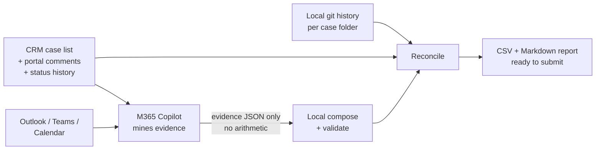

# M365 Timesheet Skill

[](https://github.com/LucioB16/m365-timesheet)
[](https://github.com/LucioB16/m365-timesheet)

Stop reconstructing your week from memory. This skill asks Microsoft 365 Copilot to mine your
Outlook, Teams and calendar activity for a date range, then **verifies every number against your
own git history and your CRM before it ever reaches a timesheet** — so submitting hours takes
minutes of review, not an evening of digging through old emails.

## 🔍 Verified, not trusted

Copilot is never asked to do arithmetic. It only mines Microsoft 365 and prints raw evidence;
every total, formatting rule and reconciliation check is re-derived locally and cross-checked
against what actually happened on disk and in the CRM. A real reconciliation finding, straight
from this project's own test data:

```text
[BLOCKING] MISSING_LOCAL_WORK 2026-11-06 Local evidence shows work on CAS-1000001-A1B1
(19 commit(s)) on 2026-11-06, but the timesheet has no entry for it.
```

That is the point of the whole project: a day's worth of real, committed work that the model's
evidence alone would have missed, caught automatically before you ever hit submit.

## 🧩 How it works



The run is **CRM-first**: it starts from the cases you're actually working on in Dataverse, then
expands with M365 discovery for meetings, emails, chats and work that isn't tied to a case.

## 🚀 Features

- **CRM-first discovery**: starts from your real Dataverse case list — including portal comments
  and field-audit status history, which reads like a dated diary of what you actually did.
- **Local verification, always**: hours, 0.25-hour rounding, daily quotas, description length and
  every roll-up are re-derived by local code, never trusted from the model's own math.
- **Three-way reconciliation**: the drafted timesheet, your local git/file history and the CRM
  are cross-checked against each other, surfacing missed work, newly discovered ticket IDs and
  client mismatches *before* submission — not after.
- **Worktree- and alias-aware**: a git linked worktree or an old folder left aliasing a renamed
  case is detected and merged into the right case, so the same commits are never double-counted.
- **Agent-agnostic**: works the same way whether you run it from Codex, Claude Code or any other
  coding agent that can drive a browser and a Node.js CLI.

## ⚡ Quick start

```bash
npm install
# create config.json from config.example.json, then log in once:
npm run setup

npm run timesheet -- "last week"
```

## 🛠️ Commands

| Command | Purpose |
| --- | --- |
| `npm run timesheet -- "<range>"` | Full run: prompt, Copilot, validate, reconcile, render |
| `npm run timesheet -- "<range>" --dry-run` | Build and print the prompt, send nothing |
| `npm run timesheet -- "<range>" --from-file <path>` | Re-parse a saved reply |
| `npm run timesheet -- "<range>" --no-crm` | Skip Dataverse |
| `npm run timesheet -- "<range>" --hours 7.5` | Override the daily quota for this run |
| `npm run evidence -- "<range>"` | Local git / file scan only |
| `npm run cases` | Dataverse case list only |
| `npm run prompt -- "<range>"` | Render the prompt only |
| `npm test` | Unit tests |

Ranges: `last week`, `this week`, `this month`, `last month`, `past 10 days`, `past 2 weeks`,
`2026-08-31..2026-09-04`, `2026-08-31 to 2026-09-04`.

## ⚙️ Configuration

`config.json` (see `config.example.json`):

| Key | Meaning |
| --- | --- |
| `USER_NAME`, `USER_EMAIL` | Who the timesheet is for |
| `CASES_ROOT` | Folder holding `<Client>/<CASE-ID> - <Title>` |
| `TIMEZONE` | Timezone the timesheet is submitted in |
| `HOURS_PER_DAY`, `WORKING_DAYS` | Daily quota and which days count |
| `INCLUDE_NON_BILLABLE` | Whether internal time is included |
| `CASE_ID_OVERRIDES` | Force a case ID when client/work-pattern matches (e.g., a recurring meeting always tied to one case) |
| `CLIENT_ALIASES` | Alias to client name, e.g. `ACME=Acme Corporation` |
| `FOLDER_TO_CLIENT` | Local folder name to official client name |
| `CRM_ENABLED`, `CRM_ORG_URL`, `CRM_AZURE_CONFIG_DIR`, `CRM_VIEW_ID` | Dataverse access |
| `CRM_AZURE_CONFIG_DIRS` | One Azure CLI profile per identity; all are queried and merged |
| `CRM_TENANT_ID` | Tenant the org lives in; required for a guest identity |
| `CRM_STATUS_COMMENT_FIELD` | Field whose audit history is read as the case diary (`new_xpoinfo`) |
| `CRM_DETAIL_MAX_CASES` | How many cases get portal comments and audit history |
| `PROMPT_EVIDENCE_CHARS` | Per-block cap on evidence sent to Copilot (default 10000) |
| `SHOW_TIMESHEET_IN_CHAT` | Print the generated timesheet table to stdout/chat after each run (default `true`) |
| `COPILOT_REPLY_TIMEOUT_MINUTES` | Max minutes to wait for Copilot reply before failing capture (default `20`) |

The date range is never stored in config; it is passed per run.

## 📤 Outputs

- `output/timesheet-<start>_<end>.csv` — the submittable CSV
- `output/timesheet-<start>_<end>--YYYY-MM.csv` — per month when the range crosses a boundary
- `output/timesheet-<start>_<end>.md` — full report, sections A) through F)
- `logs/latest_prompt.md`, `logs/latest_response.md` — kept for re-parsing

## 🧯 Exit codes

`0` clean · `1` contract or validation failure (nothing written) · `2` written but blocking
reconciliation findings · `3` run failure.

## 📝 Notes

- Read-only against `CASES_ROOT` and Dataverse. It never modifies a case folder.
- Playwright is resolved from the sibling `m365-case-intake` skill if not installed locally,
  and both skills share one persistent browser profile, so you log in once.
- In chat-driven runs, oversized descriptions are first compacted semantically by the agent AI
  and then revalidated; deterministic compaction remains as a final safety fallback.
- If Opus is unavailable (weekly limit or model menu failure), the runner automatically retries
  once without forcing model selection (uses the current/default model).
- Blocking reconciliation findings are resolved interactively, one at a time, with the user —
  and the timesheet is walked day-by-day for final confirmation before it's done. See
  "Resolving blocking findings interactively" and "Final review before declaring the timesheet
  done" in `SKILL.md`.
- See `SKILL.md` for the output contract, the reconciliation rules, the two-identity CRM note
  and troubleshooting.
